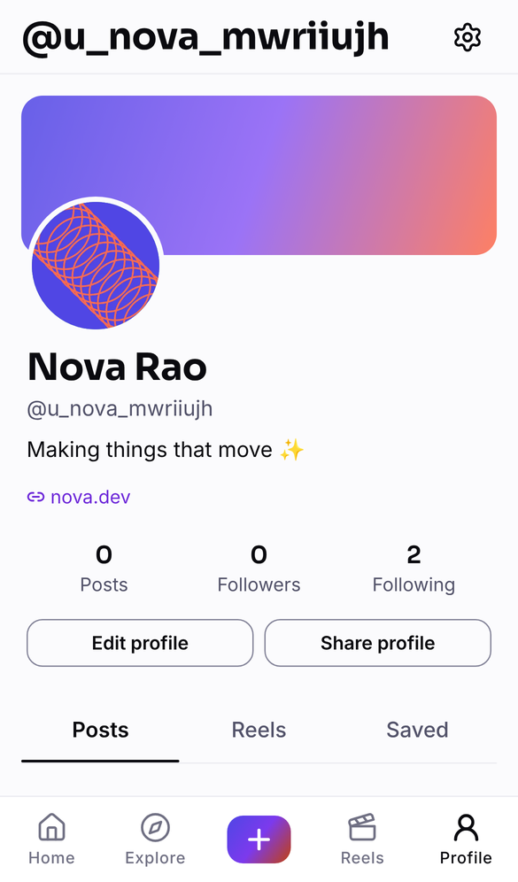
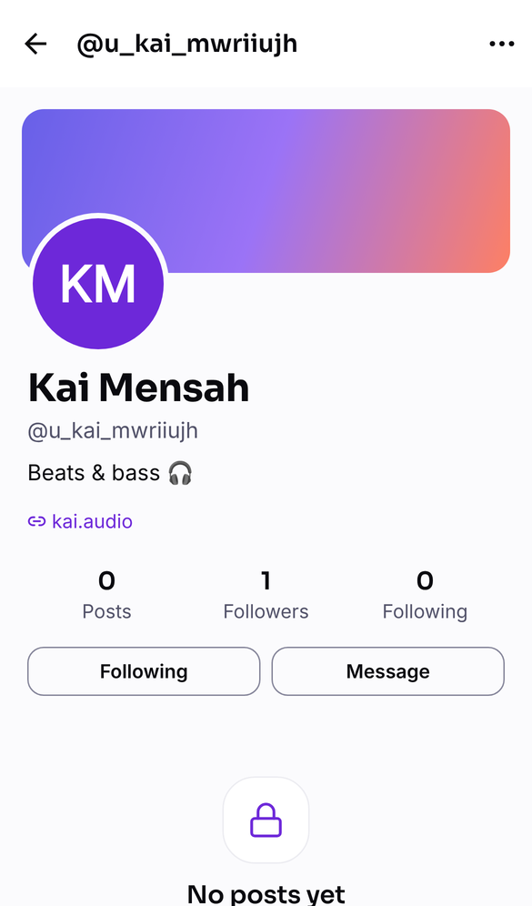
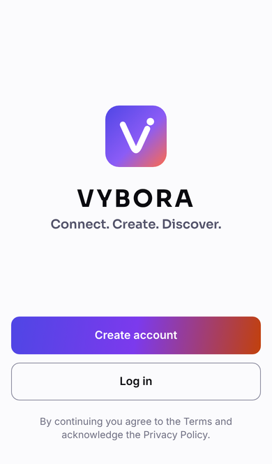
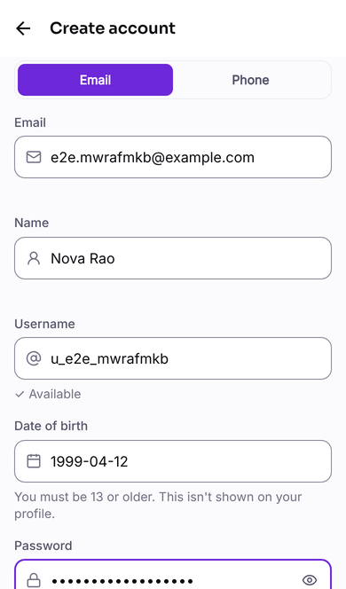
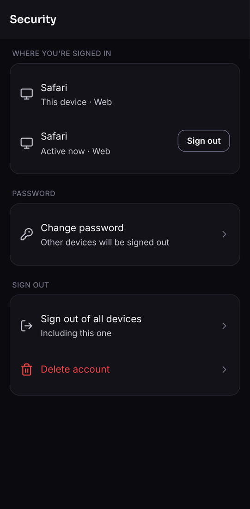
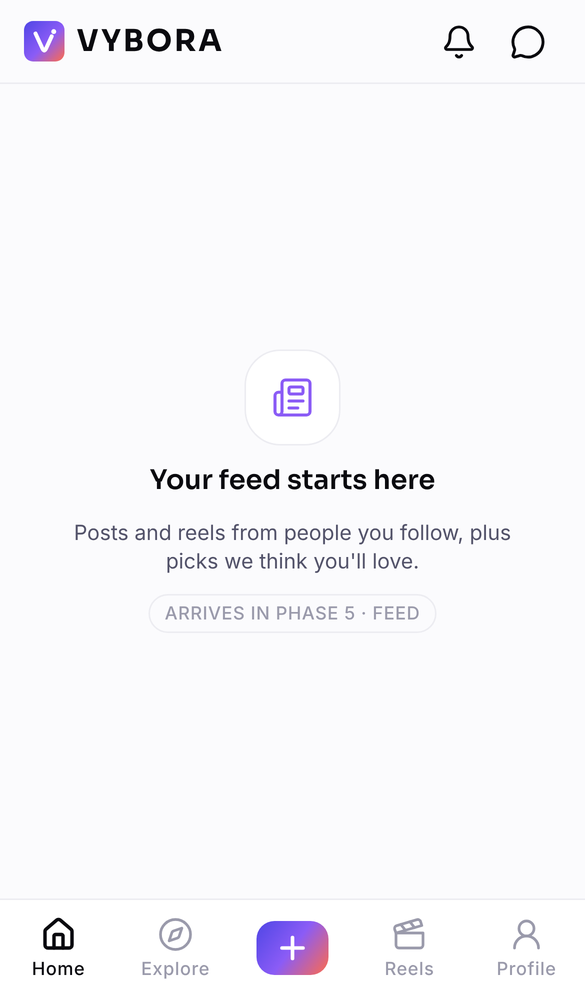
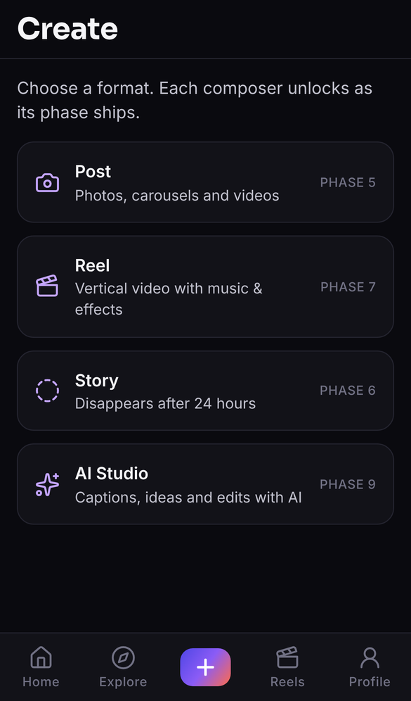
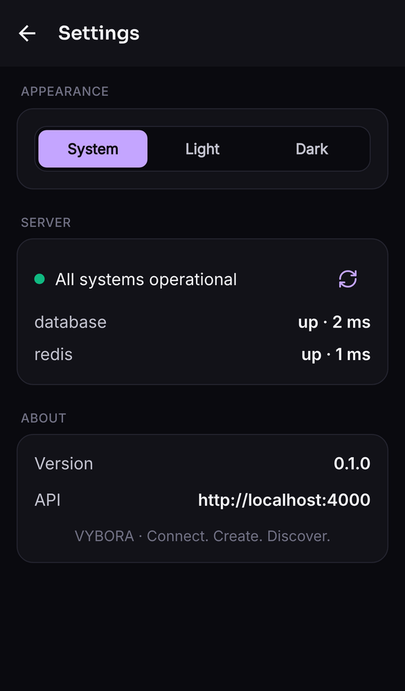
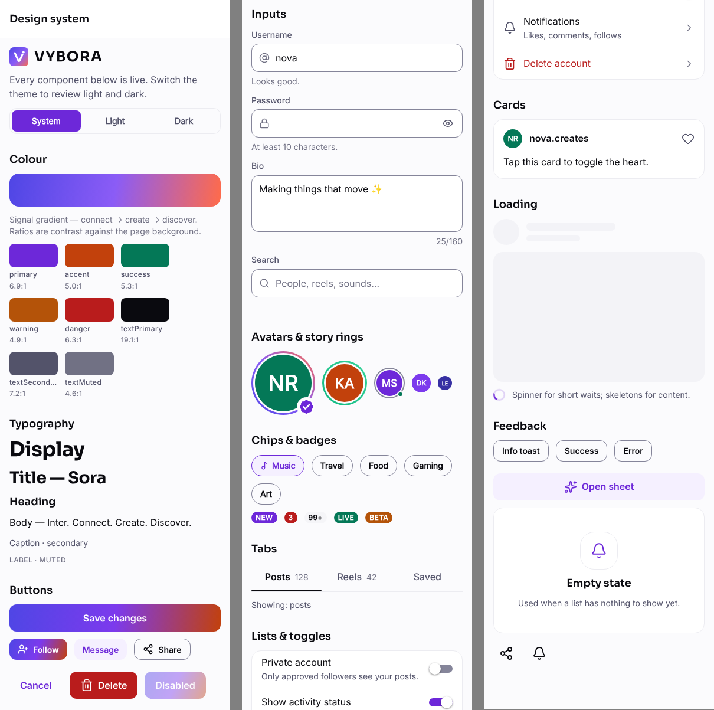

# VYBORA

**Connect. Create. Discover.**

A next-generation social platform: social feed, short video (Reels), stories,
music, communities, real-time messaging, an AI creation studio and a creator
economy — for Android, iOS and (later) Web.

> **Project status — Phase 4 (Profiles & social graph) complete.**
> Working today: accounts and sign-in (Phase 3); profiles with photo and cover uploads
> processed by a background worker; follow, private accounts with follow requests,
> block, restrict, mute and close friends; people search — all enforced by a single
> visibility policy. Next: Phase 5 (posts, feed, comments, likes and reporting).
> See the [roadmap](documentation/architecture/ROADMAP.md).

<p align="center">
  
  
  
</p>
<p align="center">
  
  
  
</p>
<p align="center">
  
  
  
</p>
<p align="center">
  
</p>

## Documentation

| Doc | What's inside |
|---|---|
| [Requirements analysis](documentation/architecture/REQUIREMENTS_ANALYSIS.md) | Scope, NFRs, risks, **decisions needing your input** |
| [Architecture](documentation/architecture/ARCHITECTURE.md) | System diagram, key decisions, module map, core flows, scaling path |
| [Roadmap](documentation/architecture/ROADMAP.md) | 16 phases with deliverables, exit criteria and estimates |
| [Third-party services](documentation/architecture/THIRD_PARTY_SERVICES.md) | Accounts to create, libraries, local substitutes |
| [Database schema](documentation/database/SCHEMA.md) | ERDs, conventions, indexes, planned migrations |
| [Feed ranking](documentation/architecture/RANKING.md) · [Music licensing](documentation/architecture/MUSIC_LICENSING.md) | Domain designs |
| [Design system](documentation/design/DESIGN_SYSTEM.md) | Tokens, accessibility rules, components |
| [Profiles, graph & media](documentation/api/SOCIAL.md) | Visibility policy, follow/block rules, upload pipeline |
| [Authentication](documentation/api/AUTH.md) | Tokens, endpoints, codes, rate limits, social sign-in, deletion |
| [API conventions](documentation/api/CONVENTIONS.md) | REST/WS conventions, errors, pagination |
| [Security](documentation/security/SECURITY.md) | Threat model, E2EE plan, GDPR |
| [Deployment](infrastructure/deployment/README.md) | AWS target architecture |

## Repository layout

```
vybora/
├── apps/
│   ├── api/        NestJS 12 API (Fastify) — Prisma schema, migrations, health, config, errors
│   ├── mobile/     Expo SDK 58 app       — Expo Router tabs, theming, API client
│   └── admin/      Next.js admin          — reserved, scaffolded in Phase 14
├── packages/
│   ├── types/      API contracts shared by all apps
│   ├── shared/     validation (username, password, hashtags, mentions), cursor pagination, constants
│   ├── ui/         design tokens + WCAG contrast checks (components: apps/mobile/src/ui)
│   └── config/     shared tsconfig
├── infrastructure/
│   ├── docker/     docker-compose: Postgres, Redis, S3 emulator (moto), Mailpit
│   └── deployment/ production deployment plan
└── documentation/  architecture · database · api · security
```

Tooling: **pnpm workspaces + Turborepo**, TypeScript 5.9, Node ≥ 22.12.

## Running locally

### Prerequisites
- Node.js 22 LTS (`nvm use`), pnpm 10 (`corepack enable`)
- Docker Desktop (or any Docker engine with Compose v2)
- For the mobile app: Expo Go on a phone, or Xcode (iOS simulator, macOS) / Android Studio (emulator)

### 1. Install
```bash
pnpm install
```

### 2. Start infrastructure
```bash
pnpm infra:up
```
| Service | URL | Credentials |
|---|---|---|
| PostgreSQL | `localhost:5432` | `vybora` / `vybora`, db `vybora` |
| Redis | `localhost:6379` | — |
| S3 storage (moto emulator) | `localhost:9000` — in-memory, uploads reset when the container restarts | any keys (`vybora` / `vybora-dev-secret` in `.env.example`) |
| Mailpit | http://localhost:8025 (SMTP `1025`) | — |

> No Docker? Any local PostgreSQL 16+ and Redis 7+ work — create a `vybora`
> user/database and point `DATABASE_URL` at it.

### 3. Configure & migrate the database
```bash
cp apps/api/.env.example apps/api/.env
pnpm db:migrate        # applies prisma/migrations
pnpm db:generate       # typed Prisma client → apps/api/src/generated (git-ignored)
```

### 4. Run the API
```bash
pnpm --filter @vybora/api dev       # http://localhost:4000/v1/health/ready
```
Uploads are processed by a media worker that runs inside the API in development
(`MEDIA_WORKER_INLINE=true`). In production run it separately: `pnpm --filter @vybora/api worker`.

### 5. Run the mobile app
```bash
cp apps/mobile/.env.example apps/mobile/.env
pnpm --filter @vybora/mobile start  # then i (iOS) · a (Android) · w (web) · or scan the QR with Expo Go
```
Create an account on the Welcome screen. Verification codes are emailed to **Mailpit**
(http://localhost:8025). With `SMS_PROVIDER=console`, SMS codes are printed in the API log.
**Profile → Settings** shows your account, devices (Security) and live server status.

### 6. Verify everything
```bash
pnpm lint && pnpm typecheck && pnpm test   # all workspaces (API e2e needs Postgres + Redis running)
pnpm --filter @vybora/api test:db         # schema smoke test
```
The same checks run in GitHub Actions on every push (`.github/workflows/ci.yml`).

### Stop
```bash
pnpm infra:down        # add -v via docker compose to wipe volumes
```

## Security notes
- Only `.env.example` files are committed; real `.env` files are git-ignored.
- Anything prefixed `EXPO_PUBLIC_` / `NEXT_PUBLIC_` ends up in client bundles — never put secrets there.
- AI, payment, SMS and storage keys live only on the API server.

## Brand
Original VYBORA identity: the **"signal" gradient** (indigo → violet → coral)
represents *connect → create → discover*. Display type: Sora; text: Inter.
Tokens in [`packages/ui`](packages/ui/src/index.ts).
