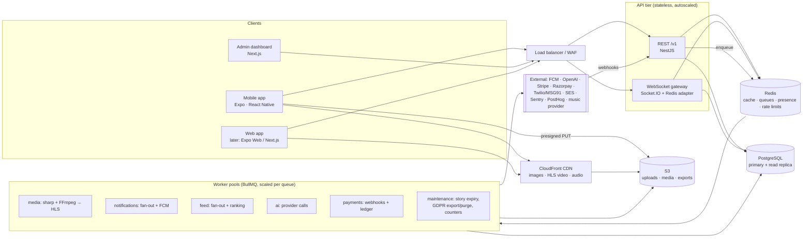

# VYBORA — System Architecture

> Status: **approved 2026-11-21**

## 1. High-level view



## 2. Architectural decisions

| Decision | Choice | Rationale |
|---|---|---|
| Backend shape | **Modular monolith** (NestJS 12, ESM, Fastify adapter) with two entrypoints: `main.ts` (HTTP+WS) and `worker.ts` (queues) | One deployable, clear module boundaries, independent scaling of the hot paths (API vs media workers). Modules communicate via services/events, never via each other's tables — so a module can be extracted later. |
| API style | REST `/v1` + WebSocket for realtime | Simple to cache, version and secure; WS only for messaging, typing, presence, live counters. |
| IDs | UUIDv7 | Time-ordered (B-tree friendly, sortable), not enumerable. |
| Pagination | Keyset cursors everywhere | Stable under inserts; O(log n) per page. |
| Auth | Short-lived JWT access (15 min) + opaque rotating refresh tokens (hashed in DB) | Revocable sessions, theft detection by reuse. |
| Media upload | Client → **presigned S3 PUT** → `media.uploaded` → worker | API never proxies bytes; uploads continue in the background via OS background URL sessions (`expo-file-system` background upload) with S3 multipart for large video. |
| Video | FFmpeg → HLS ladder (240/360/540/720/1080p), thumbnails, poster frames | Adaptive bitrate is the biggest lever for low-bandwidth markets. |
| Realtime scale | Socket.IO with Redis adapter; rooms per user & conversation | Horizontal scaling of WS nodes. |
| Queues | BullMQ on Redis | Retries, backoff, rate-limited queues (AI, SMS), scheduled jobs (story expiry). |
| Cache | Redis: feed pages, profile cards, counters, rate limits, presence | Postgres remains source of truth. |
| Search | Postgres FTS + `pg_trgm` behind `SearchIndex` interface | Swap to OpenSearch without touching callers. |
| AI | `AiProvider` interface (OpenAI adapter first, `mock` adapter for dev/tests) | Provider-agnostic; keys server-side only; per-user quotas. |
| Payments | `PaymentProvider` interface (Stripe, Razorpay); **webhook is the only source of truth** | Client success callbacks are UX only. Double-entry ledger. |
| Mobile state | TanStack Query (server state) + Zustand (client state: session, player, composer) | Clear split; query cache persisted to MMKV for instant startup. |
| Styling | Typed theme system (`useAppTheme`) on tokens from `@vybora/ui`; StyleSheet-based components | NativeWind 4 has open compatibility issues with Reanimated 4 (Expo SDK 58). The brief allows "NativeWind *or* a consistent design system"; tokens stay shared with admin (Tailwind). Revisit NativeWind 5 when stable. |

## 3. Module map (API)

```
auth ─┬─ users ─┬─ graph (follow/block/restrict/mute/close friends)
      │         ├─ privacy (settings, export, deletion)
      │         └─ notifications ── push (FCM)
media ┴─ posts ─┬─ feed (fan-out, ranking)          ┐
                ├─ reels (vertical feed, remix/duet) │ all content reads go
                ├─ comments                           │ through a single
                └─ search                             │ VisibilityPolicy
stories ── highlights                                 ┘
messaging (REST + WS) ── e2ee keys
music (MusicProvider) · communities · monetization (ledger, providers, payouts)
ai-studio (AiProvider) · moderation (reports, actions, spam) · admin (RBAC, audit)
```

**VisibilityPolicy** is one service answering *"can viewer V see entity E?"*
(blocks, private accounts, close friends, community membership, subscriber
access, moderation status). Every read path calls it — this is how we avoid
the classic social-app data leak where one endpoint forgets a privacy check.

## 4. Key flows

### 4.1 Posting a reel
1. App requests upload slot → `POST /v1/media` → `{mediaId, presignedUrl(s)}`.
2. App uploads (multipart, resumable, background) directly to `uploads` bucket.
3. App calls `POST /v1/media/:id/complete` → job `media.process`.
4. Worker: validate magic bytes & size, strip metadata (EXIF GPS), FFmpeg
   transcode → HLS ladder + poster + blurhash, write to `media` bucket,
   run moderation classifier, set `READY`.
5. App calls `POST /v1/posts` with `type=REEL` (can be called before READY;
   post publishes when media is READY).
6. `feed.fanout` job: push post id into followers' Redis timelines
   (skipped for accounts with > 10k followers — those are pulled at read time:
   **hybrid fan-out**).

### 4.2 Home feed read
`GET /v1/feed?kind=following&cursor=…` → merge pushed timeline + pulled
celebrity posts → filter through VisibilityPolicy → rank (see
[RANKING.md](./RANKING.md)) → hydrate from cache → return page + cursor.

### 4.3 Payment (tip)
1. App → `POST /v1/payments/tips` (idempotency key) → server creates
   PaymentIntent / Razorpay order, stores `Payment(PENDING)`.
2. App completes provider sheet. **Nothing is credited yet.**
3. Provider → webhook → signature verified → `WebhookEvent` stored (unique on
   provider+eventId → exactly-once) → `Payment SUCCEEDED` → ledger entries
   (`PROVIDER_CLEARING` debit; `CREATOR_PENDING` + `PLATFORM_REVENUE` credits)
   → notification to creator.
4. After refund window, maintenance job moves pending → available.

### 4.4 Message send
App emits `message:send {clientMessageId,…}` over WS → server persists
(unique `senderId+clientMessageId` ⇒ retries are idempotent) → ack → fan out to
conversation room → offline members get push. Typing/presence live only in Redis
with TTLs.

## 5. Scaling path

| Stage | Users | Shape |
|---|---|---|
| Launch | ≤ 100k MAU | 2× API, 1–2× worker per queue, RDS (Multi-AZ), 1 Redis |
| Growth | ≤ 5M MAU | Read replicas for feed/profile reads, PgBouncer, separate Redis for queues vs cache, partition `notifications`/`messages` by time |
| Scale | > 5M MAU | Extract messaging & media into services (already isolated modules), move impressions & ranking features to ClickHouse/Kafka, ML ranking service |

## 6. Repository layout

See root [README](../../README.md#repository-layout).
