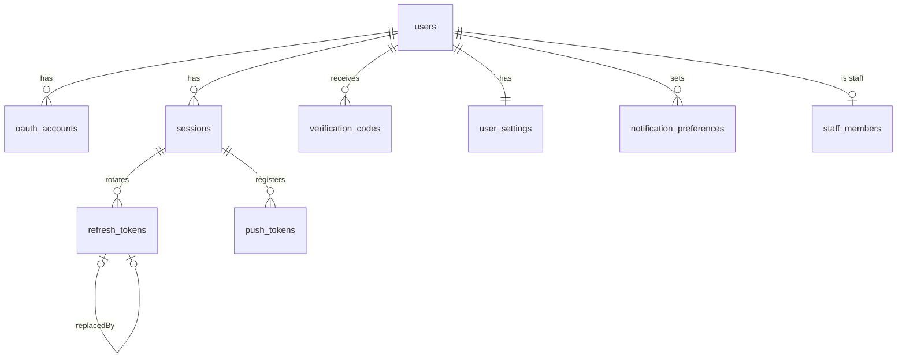
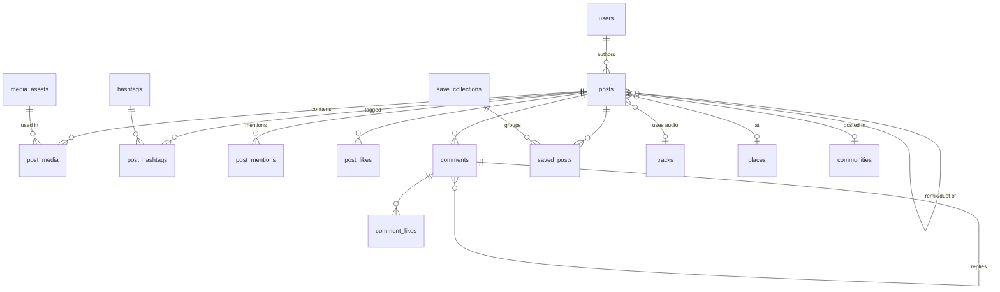
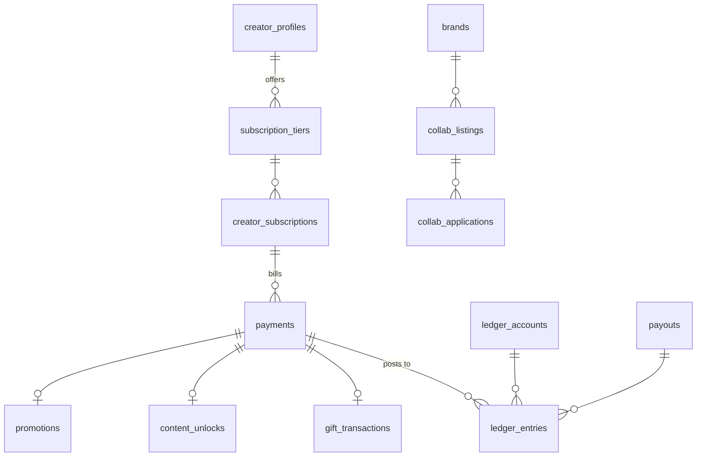

# Database Schema

Source of truth: [`apps/api/prisma/schema.prisma`](../../apps/api/prisma/schema.prisma)
· Initial migration: `apps/api/prisma/migrations/*_init/migration.sql`
· **78 tables, 49 enums** · PostgreSQL 16+ · Prisma 7.

Verified: `prisma validate` passes, the migration applies cleanly to an empty
PostgreSQL 16 database, `migrate diff` reports no drift, and
`apps/api/test/schema.smoke.test.ts` exercises users, follows, posts, media,
hashtags, likes, threaded comments, stories + stickers, DMs (idempotency), and
a balanced double-entry ledger transaction.

## Conventions

| Topic | Convention |
|---|---|
| Keys | UUIDv7 (`@default(uuid(7)) @db.Uuid`); join tables use composite PKs |
| Naming | tables `snake_case` plural; columns camelCase (Prisma default) |
| Money | `Int` minor units + `Char(3)` ISO currency. No floats, ever |
| Deletion | `deletedAt` soft-delete for UGC; account deletion = `PENDING_DELETION` + grace period → purge job; FKs cascade from `users` so a purge removes personal data |
| Counters | denormalized (`likeCount`, `followerCount`…) updated transactionally or by jobs; recount jobs can rebuild from source rows |
| Enums | Postgres enums; mirrored as string unions in `@vybora/types` |
| Not stored here | presence, typing, rate-limit buckets, feed timelines, seen-sets, impressions (Redis / analytics) |

## Domains & ERD

### Identity & auth

- `refresh_tokens.tokenHash` is SHA-256 of an opaque random token. On refresh,
  the presented token is marked `rotatedAt`, a new one is linked via
  `replacedById`. Presenting an already-rotated token ⇒ revoke the session.
- `users.tokenVersion` is embedded in access JWTs; bumping it kills all access
  tokens within ≤ 15 min (password change, "log out everywhere").
- OTPs (`verification_codes`) are hashed with a server pepper, expire in 10 min,
  max 5 attempts.

### Social graph
`follows (followerId, followingId, status)` · `blocks` · `restricts` · `mutes` ·
`close_friends` · `interests` / `user_interests`.
Indexes on `(followingId, status, createdAt)` and `(followerId, status, createdAt)`
serve follower/following lists and request inboxes.

### Content

- **Reels are posts** (`type = REEL`) — one engagement stack (likes, comments,
  saves, reports, ranking) for all formats.
- Paid/exclusive content: `accessLevel` (`FREE|SUBSCRIBERS|PAID`) + `priceMinor`.
- Key indexes: `(authorId, publishedAt DESC)` profile grid;
  `(type, status, publishedAt DESC)` & `(type, status, rankScore DESC)` for
  reels/trending; `(communityId, publishedAt DESC)`.

### Stories
`stories` (24h via `expiresAt`, kept for archive/highlights) · `story_stickers`
(type + JSON layout/data) · `sticker_responses` · `story_views` ·
`story_reactions` · `story_audience_members` (custom audience) · `highlights` /
`highlight_items`. Story replies are `messages` with `storyId`.

### Messaging
`conversations` (DIRECT has unique `directKey` = sorted user ids) ·
`conversation_members` (role, request flag, read watermark, mute/archive/pin) ·
`messages` (unique `senderId + clientMessageId` for idempotent retries;
reply/forward/share links; edit & delete tombstones) · `message_reactions` ·
`message_hidden` (delete-for-me) · E2EE: `e2ee_devices`,
`e2ee_one_time_prekeys`, `message_envelopes` (per-device ciphertext; server
holds only public keys and opaque bytes).

### Music
`artists` (optionally linked to a user) · `tracks` (provider, licence JSON,
expiry) · `artist_follows` · `playlists` · `playlist_tracks` (fractional-index
ordering for concurrent collaborative edits) · `playlist_collaborators`.

### Communities
`communities` · `community_members` (role + status incl. PENDING/BANNED) ·
`community_interests` · `community_events` · `community_event_rsvps`.
Community chat = `conversations.type = COMMUNITY`.

### Monetization

- **`webhook_events`** unique on `(provider, eventId)` ⇒ each provider event is
  processed exactly once.
- **Double-entry ledger**: every money movement is a `transactionId` whose
  debits equal credits. Creator balance = credits − debits on their
  `CREATOR_AVAILABLE` account. Entries are never updated or deleted —
  corrections are new reversing entries.

### Notifications, trust & safety, AI, privacy
`notifications` (polymorphic `entityType/entityId`, `groupKey` for
aggregation) · `reports` (priority-ordered queue) · `moderation_actions`
(manual & automated) · `verification_requests` · `audit_logs` (append-only) ·
`ai_jobs` (provider, tokens, cost) · `content_calendar_entries` ·
`data_export_requests`.

## Planned follow-up migrations
| Phase | Migration |
|---|---|
| 5 | `pg_trgm` extension + GIN indexes on `users.username`, `users.displayName`, `hashtags.name`; FTS `tsvector` on `posts.caption` |
| 8 | Monthly partitioning plan for `messages` (when volume warrants) |
| 12 | Partial index `notifications (recipientId) WHERE readAt IS NULL` |
| 15 | Deferred constraint trigger asserting ledger balance per `transactionId`; revoke UPDATE/DELETE on `ledger_entries` & `audit_logs` from the app role |
